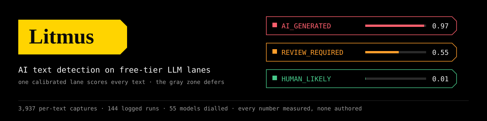
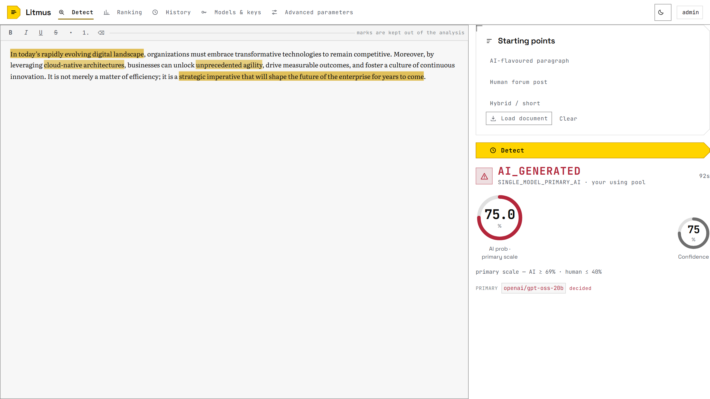
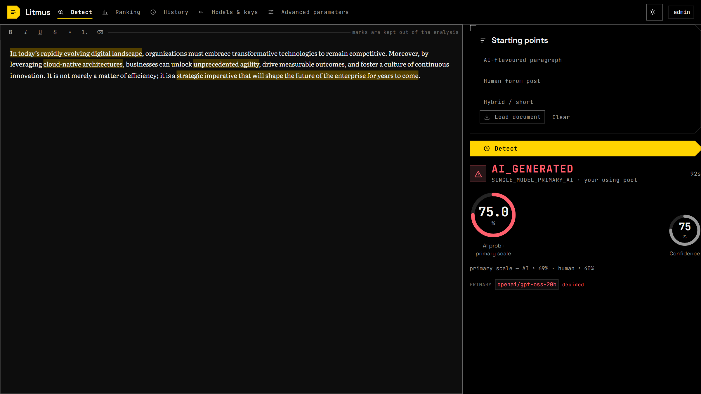
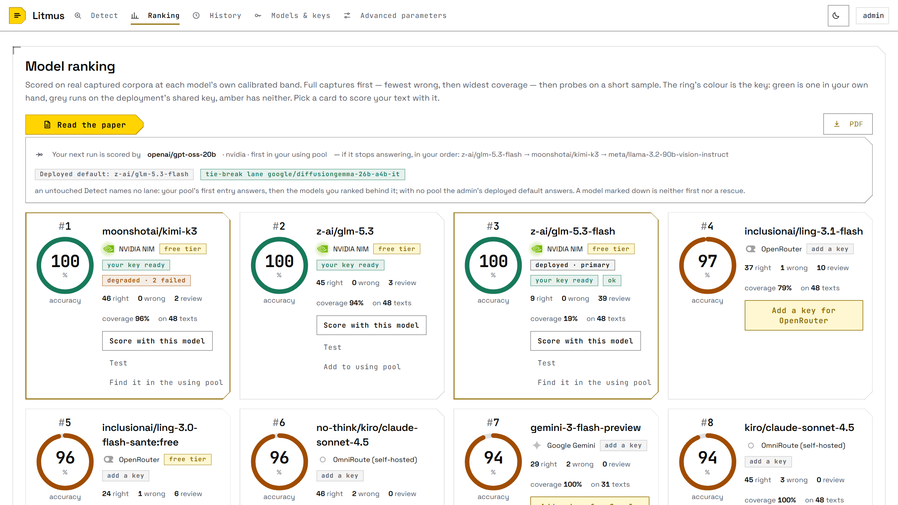
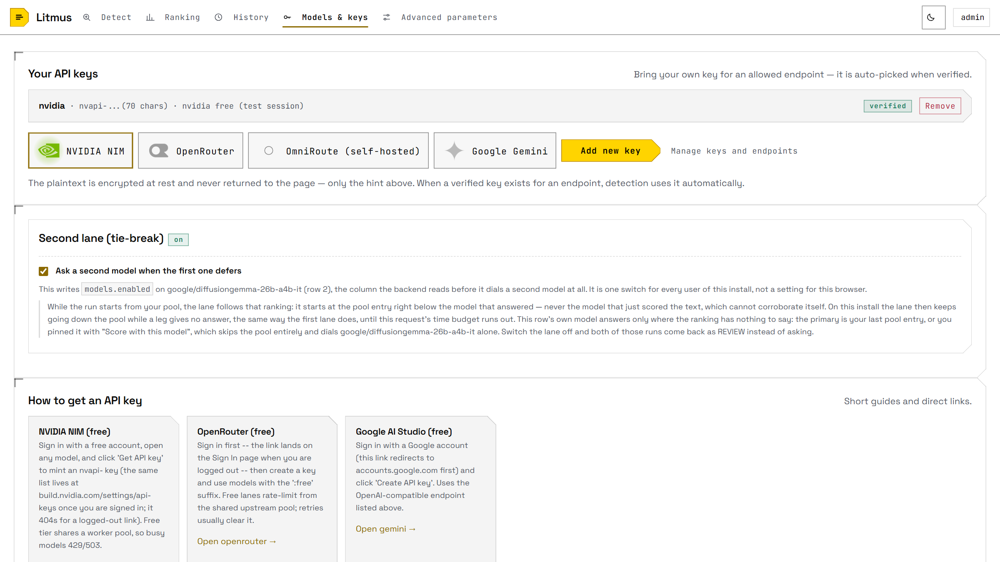
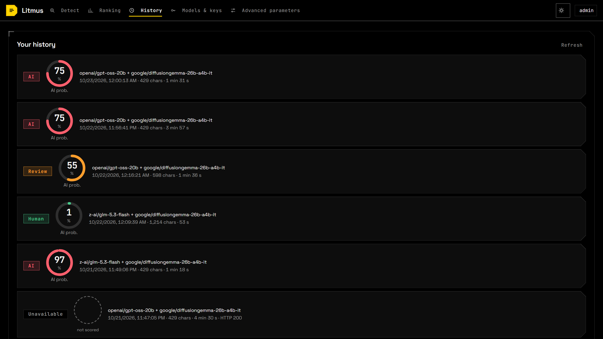

# Litmus

Judges whether a piece of text was written by an AI, on API keys you can get for free.

One calibrated model lane scores every text; an optional second-opinion lane resolves only the
gray zone. Nothing is a threshold someone picked at a desk — every band in the ranking was
measured against a 48-text human/AI corpus, and the number you see on screen comes with the ruler
it was read against and the phrases that moved it.

| | |
| --- | --- |
| **3,937** | per-text captures, kept in the citable deposit |
| **144** | logged benchmark runs |
| **55** | models dialled to find out which of them answer |
| **0** | numbers in the README that were authored rather than measured |

The full documentation — the ranking table, how the using pool works, what an admin can change and
what a plain user can, the deploy recipe and its nesting, the visual language rule — lives in
**[`ai-text-detector/README.md`](ai-text-detector/README.md)**. This page is the front door.



Three things a bare score hides are on screen above: **which lane answered**
(`PRIMARY openai/gpt-oss-20b · decided`), **the ruler the number was read against**
(`primary scale — AI ≥ 69% · human ≤ 40%` — that model's own calibrated band, not a global 50%),
and **which phrases pushed it** (the yellow plates; each one is a quote the lane itself returned).
A verdict that cannot name all three is not offered: an un-scored run renders as *not scored*,
never as 0%.

| the same run in dark mode | the measured ranking, with the failover order your next run will follow |
| --- | --- |
|  |  |
| **bring your own key** — encrypted at rest, shown as a hint, never returned to the page | **history** — every run keeps its lane, its latency and its scale |
|  |  |

## Run it

```bash
cd ai-text-detector
cp .env.example .env      # then set PRIMARY_API_KEY — a free NVIDIA NIM key works
python -m backend.seed    # providers, keys, lane models and their measured bands -> SQLite
./quickstart.sh           # starts whatever is down and prints the three URLs
```

Open <http://localhost:4200>, pick *AI-flavoured paragraph*, press **Detect**. A short paragraph
answers in about 7 s; a full document took 86 s on the free NVIDIA pool, so wait before calling it
dead.

No Docker, no PostgreSQL, no Python detector service: Angular → Flask + SQLite → the scoring
engine → any OpenAI-compatible gateway. The engine has two implementations — the n8n workflow (what
the container and the dev stack run) and the same logic ported to Python inside the backend (what
the packaged local app runs, so it needs no workflow server). `tools/engine_parity.py` proves the
two agree case for case.

## The request-hardening layer

Security headers with a CSP, CSRF double-submit, a login throttle, a payload ceiling and an SSRF
guard on every outbound address a caller can name — each one backed by a check that actually runs,
and each one claimed with the limit it does not cross (the local app is plain http on loopback, so
`Secure` is off by default and the cookie's protection is `SameSite` plus the token, not transport):

| evidence | result |
| --- | --- |
| `pytest` — hermetic backend specs | **312 passed** |
| `ng test` — SPA specs, wired through the real `appConfig.providers` | **305 passed** |
| `tools/verify_security_layer.py` — a booted server, not a test client | **22 / 22** |
| `tools/verify_deploy_recipe.py` — the header/timeout nesting, statically | **59 / 59** |
| `nginx -t` on the shipped config | `test is successful` |

[`ai-text-detector/README.md` → *The request-hardening layer*](ai-text-detector/README.md#the-request-hardening-layer)
explains what each guard does and what it deliberately does not claim.

## Layout

```
ai-text-detector/   the app: Flask backend, Angular SPA, n8n workflow, tools/, tests/, docker/
research/           four deep-research reports kept as working notes
```

## Cite the research

The benchmark behind the ranking table is deposited with a DOI:
[10.5281/zenodo.23460013](https://doi.org/10.5281/zenodo.23460013) — the ranking table, the 3,937
per-text captures and the run manifest, generated by `tools/zenodo_package.py` from the same
database rows the app serves. The deposit is citable because its tables reproduce: the check that
matters re-scores the per-text file at each model's own exported band and requires the ranking
columns to fall out.
